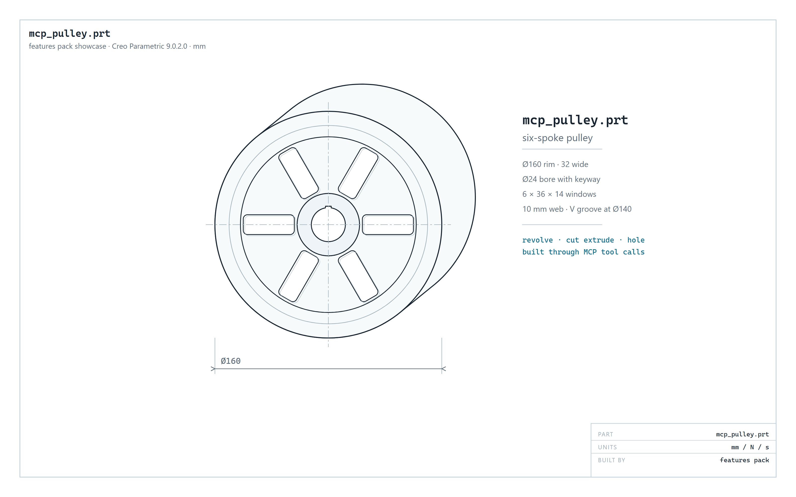
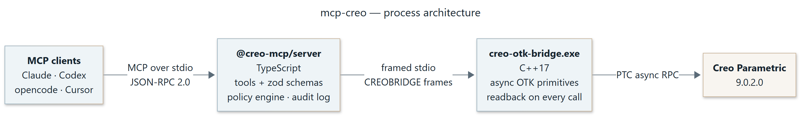
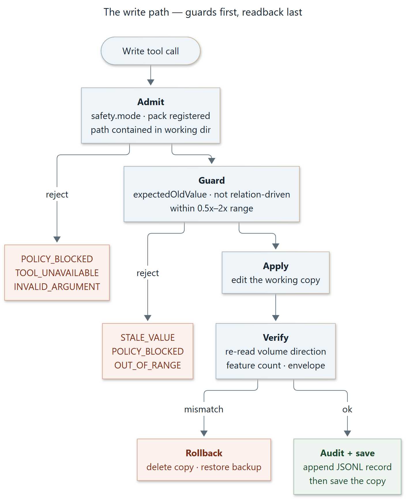

# DNK MCP Creo

**A [Model Context Protocol](https://modelcontextprotocol.io) server for PTC Creo Parametric.**

[](LICENSE)
[](https://nodejs.org)
[](https://github.com/EdwardNguyen2854/dnk-mcp-creo/actions/workflows/ci.yml)
[](https://modelcontextprotocol.io)
[](#compatibility-and-limitations)



DNK MCP Creo connects MCP clients such as Claude Desktop, Codex, opencode, and
Cursor to a live **PTC Creo Parametric** session. It uses a thin, out-of-process
C++ **Object TOOLKIT (OTK)** bridge and a typed TypeScript server, so an agent can
inspect a model, export it, author real solid features, and generate drawings —
with every write guarded, verified, and audited.

> **Status: 0.1.0 — first public release.** 65 tools across 6 packs (core plus
> 5 opt-in), 122 mock tests, and live verification against Creo Parametric
> 9.0.2.0. The implementation covers milestones M1–M5 partially; see
> [docs/ROADMAP.md](docs/ROADMAP.md) for exactly what is done and what is not.

---

## What it does

| Capability | Examples |
|---|---|
| **Inspect** | Session and working directory, open models, parameters, dimensions, features, relations, mass properties, materials, layers, units, geometry, edges, surfaces, family tables |
| **Export** | STEP, IGES, STL (ASCII/binary), drawing PDF, DXF |
| **Model** | Save, rename, copy, regenerate, parameters, dimensions, suppress/resume/delete/reorder features, create parts and assemblies, assemble components, part from template |
| **Author geometry** | Extrude, revolve, round, chamfer, shell, datum plane/axis/point, straight and counterbored/countersunk holes, linear and axis-driven patterns, feature-tree readback |
| **Draw** | Create drawings from templates, add sheets and views, generate a standard drawing with optional PDF/DXF, save |
| **Stay safe** | Read-only by default, pack gating, path containment, value guards, copy-modify-verify, rollback, JSONL audit |

The showcase part above is built end to end by
[`scripts/build-showcase-model.mjs`](scripts/build-showcase-model.mjs): a
six-spoke pulley with a Ø160 rim, six cut windows, a Ø24 keyed bore, and
volume-verified geometry.

## Why this design

- **Out-of-process async OTK bridge.** No code is loaded into Creo, the undo
  stack is left alone, and the bridge can change without restarting Creo.
- **Thin bridge, smart server.** Safety policy, guards, copy-modify-verify,
  allowlists, and audit live in TypeScript. Adding a rule never requires
  recompiling C++.
- **Versioned framed protocol.** Every bridge line carries a `__CREOBRIDGE__`
  prefix, so stray PTC output cannot corrupt the JSON stream.
- **Small context, explicit capability.** Packs are opt-in (except `core`). The
  agent sees only the tools you enable, not all 65.

## Architecture



```text
MCP clients (Claude, Codex, opencode, Cursor)
      |  stdio (JSON-RPC 2.0, MCP)
+-----v------------------------------------------------------+
| dnk-mcp-creo  (TypeScript, @modelcontextprotocol/sdk)      |
|   tools + zod schemas + policy + safe-write + audit        |
+-----+------------------------------------------------------+
      |  versioned JSON-RPC over stdio ("__CREOBRIDGE__" frames)
+-----v------------------------------------------------------+
| creo-otk-bridge.exe  (C++17, Creo Object TOOLKIT async)    |
+-----+------------------------------------------------------+
      |
   Creo Parametric 9.0.2.0
```

The editable Mermaid source is in
[`docs/assets/architecture.mmd`](docs/assets/architecture.mmd). More detail:
[docs/ARCHITECTURE.md](docs/ARCHITECTURE.md).

## Quick start

**Prerequisites:** Windows, PTC Creo Parametric 9.0.2.0 with Pro/TOOLKIT/OTK C++,
Visual Studio 2022 with the C++ workload, Node.js 20+, and a Creo license with
OTK feature `222` (or build with `-UseNo222`).

```powershell
# 1) Install
npm install

# 2) Build the native bridge (auto-detects the Creo installation)
npm run build:native

# 3) Build the server
npm run build

# 4) Diagnose without Creo
npm run doctor:mock

# 5) Diagnose with Creo running
npm run doctor

# 6) Run the live integration smoke test
node scripts/integration-smoke.mjs
```

You do not need Creo to run the test suite:

```powershell
npm test
```

## Connect a client

Copy the matching template from [`config/clients/`](config/clients/) and replace
`<REPO_ROOT>` and `<CREO_INSTALL_DIR>`:

| Client | Template | Typical location |
|---|---|---|
| Claude Desktop | [`claude_desktop_config.json`](config/clients/claude_desktop_config.json) | Claude Desktop config |
| Codex CLI | [`codex.toml`](config/clients/codex.toml) | `~/.codex/config.toml` |
| opencode | [`opencode.json`](config/clients/opencode.json) | opencode config |
| Cursor | [`cursor.mcp.json`](config/clients/cursor.mcp.json) | `.cursor/mcp.json` |

Minimal configuration (`dnk-mcp-creo.json`):

```json
{
  "creo": {
    "installDir": "<CREO_INSTALL_DIR>",
    "connectMode": "attach"
  },
  "safety": {
    "mode": "read-only"
  },
  "tools": {
    "packs": ["core", "read"]
  }
}
```

Full settings and troubleshooting: [docs/SETUP.md](docs/SETUP.md).

## Tool packs

| Pack | Tools | Enable with | Status |
|---|---:|---|---|
| `core` | 7 | always on | Verified |
| `read` | 14 | `packs: ["core", "read"]` | Verified |
| `export` | 5 | `packs: ["core", "export"]` | Verified |
| `modeling` | 14 | `packs: ["core", "modeling"]` | Partial — copy-modify rollback pending |
| `drawing` | 14 | `packs: ["core", "drawing"]` | Partial — ISO release workflow pending |
| `features` | 11 | `packs: ["core", "features"]` | Partial — drafts, sweeps, mirror withheld |

Start with `core` and `read`, then add only the packs you need. See
[docs/TOOLS.md](docs/TOOLS.md) for every tool, input, and output.

## Safety

The default safety mode is **read-only**. Writes require an explicit mode change
and are gated by the tool's write registration.



- **Path containment.** Every file operation is resolved against Creo's live
  working directory; caller-supplied paths outside it are rejected.
- **Guards.** Writes can require expected-old values and verify the result by
  readback.
- **Copy-modify-verify.** Draft workflows keep the source model untouched and
  roll back on failure.
- **Audit.** Every tool call is written to an append-only JSONL audit log.

Read [docs/SAFETY.md](docs/SAFETY.md) before enabling `copy` or `live` mode. A
CAD write can change or destroy real work; use copies or version-controlled data.

## Documentation

| Document | Contents |
|---|---|
| [docs/SETUP.md](docs/SETUP.md) | Install, configure, wire clients, troubleshoot |
| [docs/TOOLS.md](docs/TOOLS.md) | Complete tool catalog |
| [docs/SAFETY.md](docs/SAFETY.md) | Safety model and write policy |
| [docs/ARCHITECTURE.md](docs/ARCHITECTURE.md) | Components and design decisions |
| [docs/PROTOCOL.md](docs/PROTOCOL.md) | Bridge protocol reference |
| [docs/ROADMAP.md](docs/ROADMAP.md) | Milestones, verified scope, open questions |
| [docs/PRIOR-ART.md](docs/PRIOR-ART.md) | References and licensing guardrails |
| [docs/ATTRIBUTION.md](docs/ATTRIBUTION.md) | Third-party notices |
| [AGENTS.md](AGENTS.md) | Repository guide for AI coding agents |

## Project layout

```text
packages/server/        TypeScript MCP server (tools, transport, policy, audit, tests)
native/otk-bridge/      C++17 OTK async bridge + vendored nlohmann/json
scripts/                Build, acceptance, and development scripts
config/clients/         Client configuration templates
docs/                   Architecture, protocol, tools, setup, safety, roadmap
.github/                CI, issue templates, Dependabot
```

## Compatibility and limitations

- **Windows only.** The native bridge requires Windows and the Creo SDK; CI runs
  the mock test suite on Windows.
- **Creo Parametric 9.0.2.0** is the verified target. Other 9.x/10.x builds
  should work once the SDK paths are confirmed.
- **Creo, Pro/TOOLKIT, and the OTK SDK are not included.** Install and license
  them yourself.
- **Not every planned tool exists.** The `modeling`, `drawing`, and `features`
  packs are partial. Check [docs/ROADMAP.md](docs/ROADMAP.md) before relying on a
  tool.
- **No npm package.** Build from source or use a GitHub release. The bridge
  needs a local PTC SDK anyway.
- **This project is independent.** It is not affiliated with, sponsored by, or
  endorsed by PTC Inc.

## Contributing

Contributions are welcome. Read [CONTRIBUTING.md](CONTRIBUTING.md) first. The
short version:

```powershell
npm run typecheck
npm test
npm run build
npm run doctor:mock
```

For security issues, follow [SECURITY.md](SECURITY.md) and do not open a public
issue. For questions and setup help, see [SUPPORT.md](SUPPORT.md). This project
follows the [Contributor Covenant](CODE_OF_CONDUCT.md).

## License and attribution

Licensed under the [Apache License 2.0](LICENSE). Third-party notices are in
[NOTICE](NOTICE) and [docs/ATTRIBUTION.md](docs/ATTRIBUTION.md).

If you use, fork, or redistribute this project, keep the copyright and NOTICE
files and credit the author:

> DNK MCP Creo by Edward Nguyen — <https://github.com/EdwardNguyen2854/dnk-mcp-creo>

The project name and logo are covered by [TRADEMARK.md](TRADEMARK.md). For
citation metadata, see [CITATION.cff](CITATION.cff).

PTC, Creo, Creo Parametric, Pro/ENGINEER, Pro/TOOLKIT, and Object TOOLKIT are
trademarks or registered trademarks of PTC Inc. or its subsidiaries. This
project is not affiliated with or endorsed by PTC.
